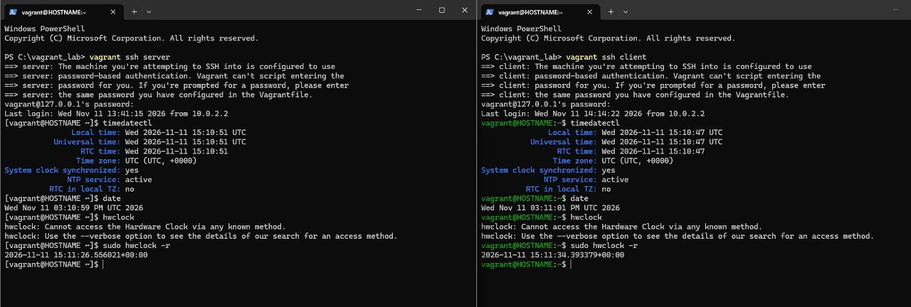
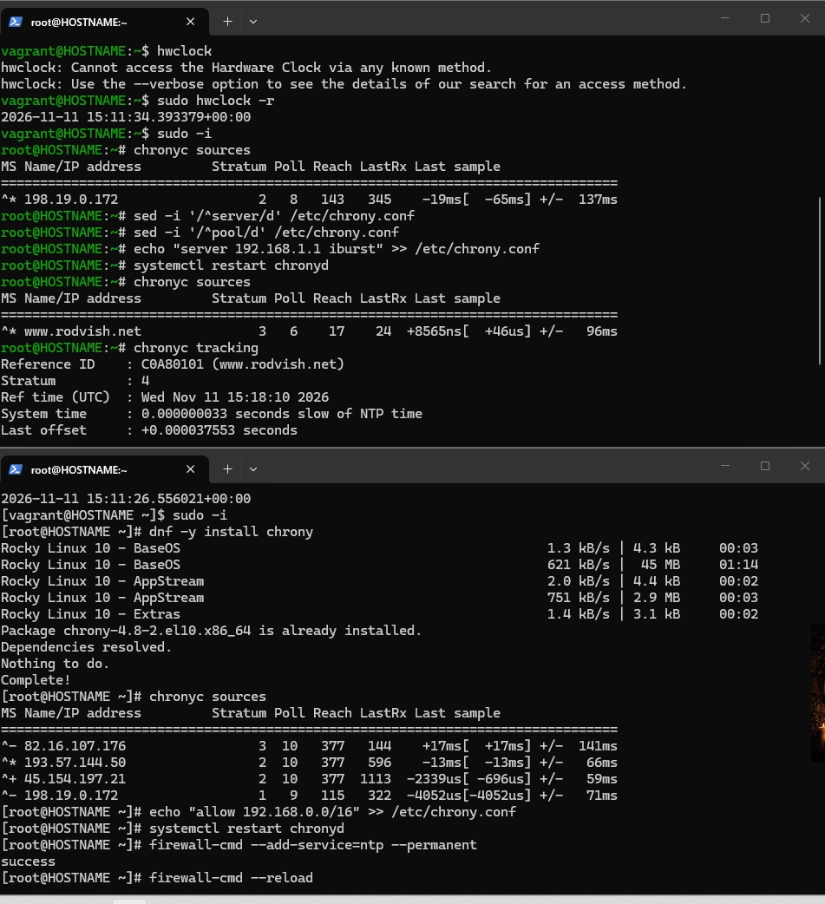
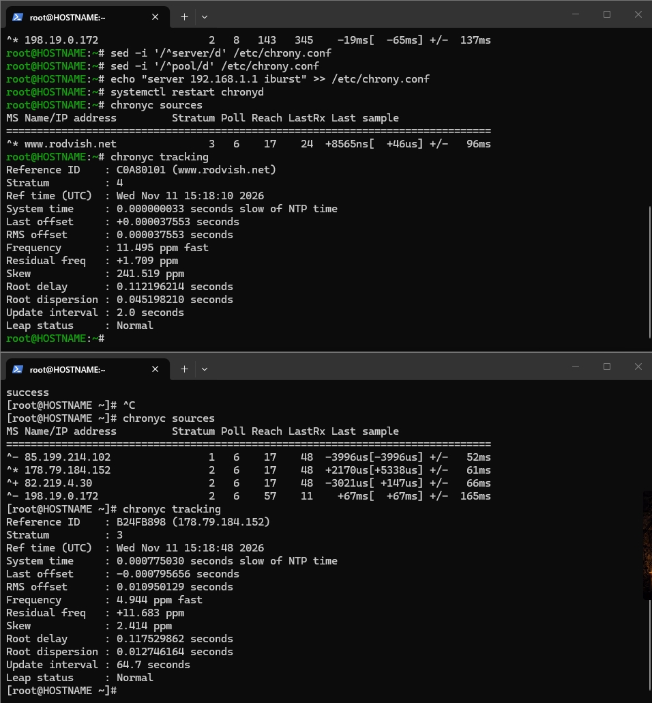
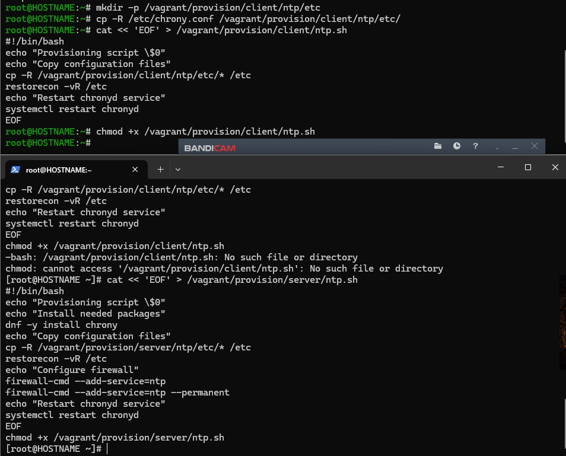
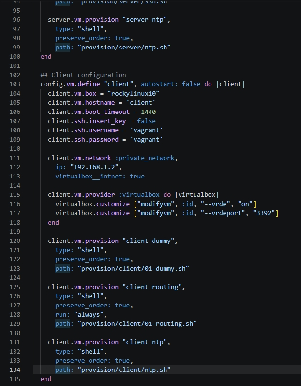

---
## Front matter
lang: ru-RU
title: Презентация по лабораторной работе 12
subtitle: Синхронизация времени
author:
  - Вишняков Родион Сергеевич
institute:
  - Российский университет дружбы народов, Москва, Россия
date: 20 ноября 2026

## i18n babel
babel-lang: russian
babel-otherlangs: english

## Formatting pdf
toc: false
toc-title: Содержание
slide_level: 2
aspectratio: 169
section-titles: true
theme: Madrid
---

# Цели и задачи работы

## Цель лабораторной работы

Получение навыков по управлению системным временем и настройке синхронизации времени.

# Процесс выполнения лабораторной работы

## Проверка текущих настроек времени на сервере (слева) и клиенте (справа). С помощью команд timedatectl, date и sudo hwclock -r просматриваются локальное, системное и аппаратное время, часовой пояс (UTC) и статус синхронизации NTP.

{ #fig:001 width=70% height=70% }

## Настройка службы chrony на сервере (нижнее окно) и клиенте (верхнее окно). На сервере проверяется наличие пакета chrony, разрешается доступ для локальной сети 192.168.0.0/16 в /etc/chrony.conf и открывается служба ntp в межсетевом экране. На клиенте удаляются стандартные пулы, прописывается локальный сервер 192.168.1.1 и перезапускается chronyd.

{ #fig:002 width=70% height=70% }

## Проверка синхронизации времени с помощью chronyc sources и chronyc tracking. На сервере (снизу) отображается синхронизация с внешними NTP-серверами (Stratum 3), а на клиенте (сверху) — успешная синхронизация с настроенным локальным сервером www.rodvish.net (Stratum 4).

{ #fig:002 width=70% height=70% }

## Создание скриптов автоматизации Vagrant. На клиенте (сверху) и сервере (снизу) копируются конфигурационные файлы /etc/chrony.conf в общую папку /vagrant/provision/ и создаются исполняемые скрипты ntp.sh для автоматической настройки chrony и брандмауэра.

{ #fig:003 width=70% height=70% }

## Редактирование Vagrantfile на хост-машине. В секции конфигурации сервера и клиента добавлены блоки provision, вызывающие созданные скрипты provision/server/ntp.sh и provision/client/ntp.sh.
 
{ #fig:001 width=70% height=70% }

# Выводы по проделанной работе

## Вывод

Мы получили навыки по управлению системным временем и настройке синхронизации времени.
