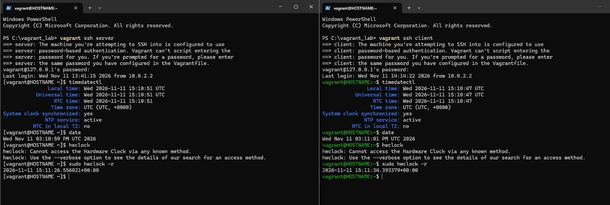
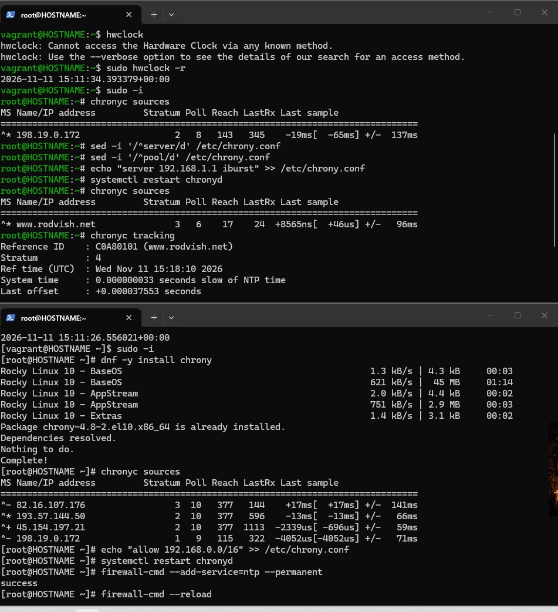
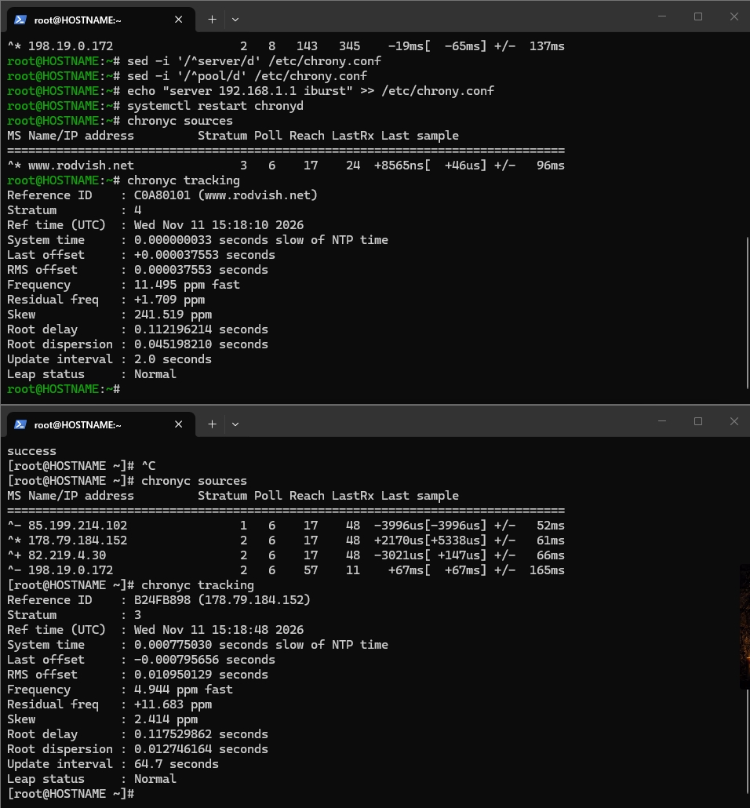
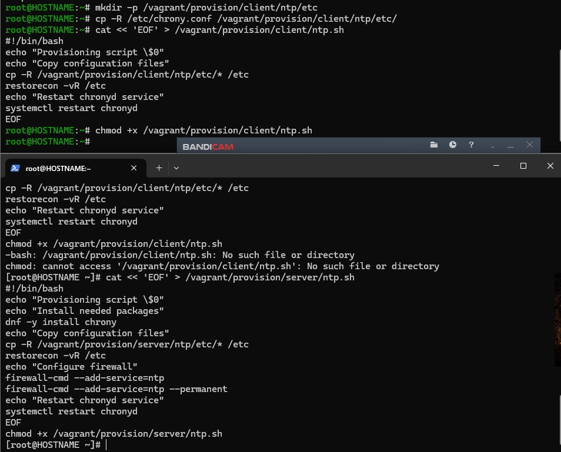
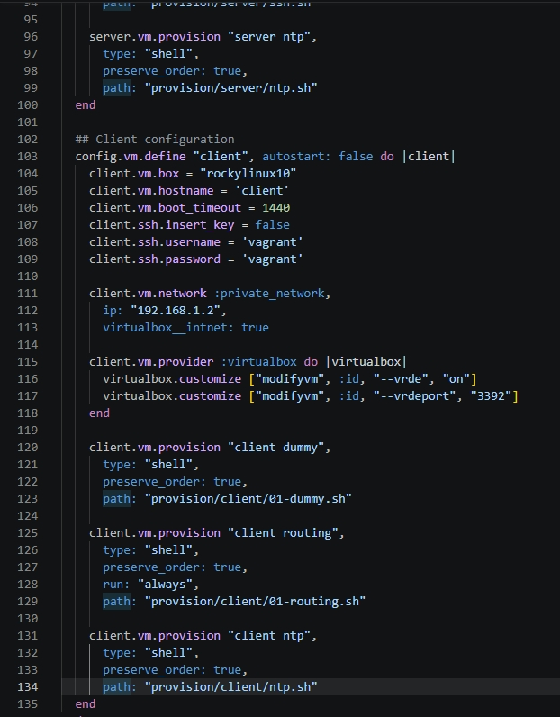

---
## Front matter
title: "Отчёт по лабораторной работе 12"
subtitle: "Синхронизация времени"
author: "Вишняков Родион Сергеевич"

## Generic otions
lang: ru-RU
toc-title: "Содержание"

## Bibliography

## Pdf output format
toc: true # Table of contents
toc-depth: 2
lof: true # List of figures
lot: true # List of tables
fontsize: 12pt
linestretch: 1.5
papersize: a4
documentclass: scrreprt
## I18n polyglossia
polyglossia-lang:
  name: russian
  options:
	- spelling=modern
	- babelshorthands=true
polyglossia-otherlangs:
  name: english
## I18n babel
babel-lang: russian
babel-otherlangs: english
## Fonts
mainfont: IBM Plex Serif
romanfont: IBM Plex Serif
sansfont: IBM Plex Sans
monofont: IBM Plex Mono
mathfont: STIX Two Math
mainfontoptions: Ligatures=Common,Ligatures=TeX,Scale=0.94
romanfontoptions: Ligatures=Common,Ligatures=TeX,Scale=0.94
sansfontoptions: Ligatures=Common,Ligatures=TeX,Scale=MatchLowercase,Scale=0.94
monofontoptions: Scale=MatchLowercase,Scale=0.94,FakeStretch=0.9
mathfontoptions:
## Biblatex
  - parentracker=true
  - backend=biber
  - hyperref=auto
  - language=auto
  - autolang=other*
  - citestyle=gost-numeric
## Pandoc-crossref LaTeX customization
figureTitle: "Рис."
tableTitle: "Таблица"
listingTitle: "Листинг"
lofTitle: "Список иллюстраций"
lotTitle: "Список таблиц"
lolTitle: "Листинги"
## Misc options
indent: true
header-includes:
  - \usepackage{indentfirst}
  - \usepackage{float} # keep figures where there are in the text
  - \floatplacement{figure}{H} # keep figures where there are in the text
---

# Цель работы

Получение навыков по управлению системным временем и настройке синхронизации времени.

# Выполнение лабораторной работы

Проверка текущих настроек времени на сервере (слева) и клиенте (справа). С помощью команд timedatectl, date и sudo hwclock -r просматриваются локальное, системное и аппаратное время, часовой пояс (UTC) и статус синхронизации NTP.

{ #fig:001 width=70% height=70% }

Настройка службы chrony на сервере (нижнее окно) и клиенте (верхнее окно). На сервере проверяется наличие пакета chrony, разрешается доступ для локальной сети 192.168.0.0/16 в /etc/chrony.conf и открывается служба ntp в межсетевом экране. На клиенте удаляются стандартные пулы, прописывается локальный сервер 192.168.1.1 и перезапускается chronyd.

{ #fig:002 width=70% height=70% }

Проверка синхронизации времени с помощью chronyc sources и chronyc tracking. На сервере (снизу) отображается синхронизация с внешними NTP-серверами (Stratum 3), а на клиенте (сверху) — успешная синхронизация с настроенным локальным сервером www.rodvish.net (Stratum 4).

{ #fig:002 width=70% height=70% }

Создание скриптов автоматизации Vagrant. На клиенте (сверху) и сервере (снизу) копируются конфигурационные файлы /etc/chrony.conf в общую папку /vagrant/provision/ и создаются исполняемые скрипты ntp.sh для автоматической настройки chrony и брандмауэра.

{ #fig:003 width=70% height=70% }

Редактирование Vagrantfile на хост-машине. В секции конфигурации сервера и клиента добавлены блоки provision, вызывающие созданные скрипты provision/server/ntp.sh и provision/client/ntp.sh.
 
{ #fig:001 width=70% height=70% }

# Вывод

Мы получили навыки по управлению системным временем и настройке синхронизации времени.

# Контрольные вопросы 

1. Почему важна точная синхронизация времени для служб баз данных?
Точное время критически важно для сохранения целостности данных, определения строгого порядка выполнения транзакций и корректной работы репликации между серверами. Расхождение во времени между узлами может привести к перезаписи актуальных данных устаревшими, конфликтам транзакций и ошибкам при восстановлении базы из журналов (логов).
2. Почему служба проверки подлинности Kerberos сильно зависит от правильной синхронизации времени?
Kerberos использует временные метки в билетах аутентификации для защиты от атак повторного воспроизведения (replay attacks). Если разница во времени между клиентом и сервером аутентификации (KDC) превышает допустимый предел (по умолчанию 5 минут), система считает билет недействительным и отказывает в доступе.
3. Какая служба используется по умолчанию для синхронизации времени на RHEL 7?
По умолчанию используется служба chronyd (пакет chrony).
4. Какова страта по умолчанию для локальных часов?
Для локальных часов по умолчанию используется страта 10 (Stratum 10).
5. Какой порт брандмауэра должен быть открыт, если вы настраиваете свой сервер как одноранговый узел NTP?
Необходимо открыть порт 123/UDP (в firewalld это соответствует службе ntp).
6. Какую строку вам нужно включить в конфигурационный файл chrony, если вы хотите быть сервером времени, даже если внешние серверы NTP недоступны?
В файл /etc/chrony.conf необходимо добавить строку: local stratum 10 (вместо 10 может быть указано другое значение страты).
7. Какую страту имеет хост, если нет текущей синхронизации времени NTP?
Несинхронизированный хост имеет страту 16 (Stratum 16).
8. Какую команду вы бы использовали на сервере с chrony, чтобы узнать, с какими серверами он синхронизируется?
Команду chronyc sources (или chronyc sources -v для вывода с подробным описанием столбцов).
9. Как вы можете получить подробную статистику текущих настроек времени для процесса chrony вашего сервера?
С помощью команды chronyc tracking.

